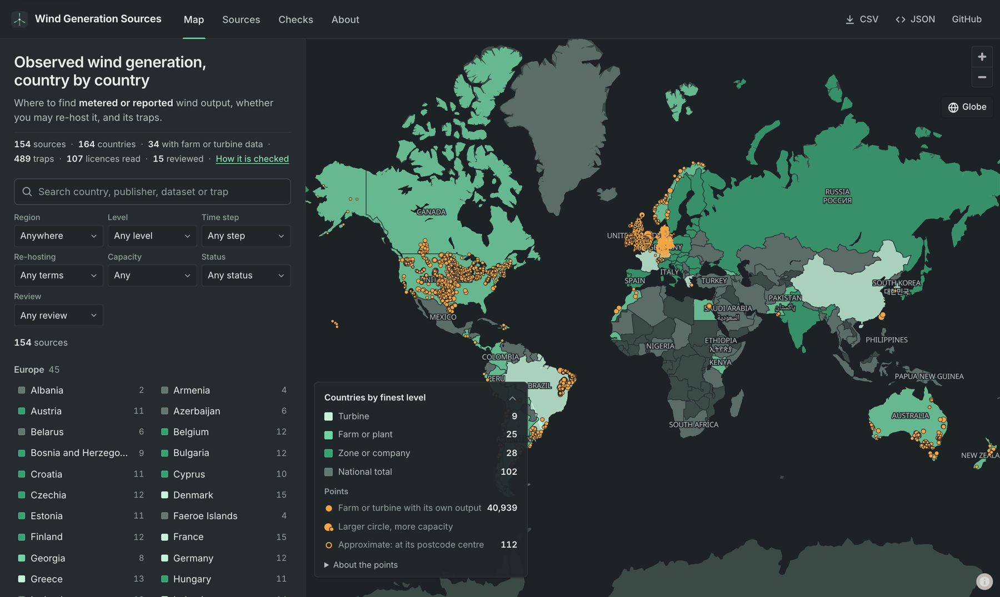

# Wind Generation Sources

Where to find **observed** wind power generation data, country by country: what each source
publishes, how to get it, whether you may re-host it, and what goes wrong when you use it.

[](https://ellyess.github.io/wind-generation-sources/)

As of November 2026 it lists 154 sources covering 164 countries, with 489 documented traps and
107 licences read on the publisher's own page.

## Why it exists

I spent a large part of my PhD tracking down observed wind generation data, scattered across
grid operators, market operators, statistics offices and research archives, with licences and
traps rarely written down. I had to list the sources out again for each piece of work. This
catalogue publishes that list so you can start from it instead of repeating the search.

— Ellyess F. Benmoufok

## What an entry tells you

Each source is one YAML file in [`sources/`](sources/). An abridged example:

```yaml
id: nordic-esett-production-volumes
publisher: eSett Oy (Nordic imbalance settlement responsible)
countries: [FI, NO, SE]
level: zone                 # from turbine up to country
measure: metered-energy
resolution: 15min
coverage:
  start: 2017
  update: daily, with a lag of days to weeks that differs by country
traps:
  - summary: Danish areas have no wind split; all production is in the "other" column.
    evidence: https://api.opendata.esett.com/EXP16/Volumes?...
  - summary: Asking for several zones in one request returns their sum, not one series per zone.
```

Full entries also record access (API, bulk download or portal, and whether a key is needed),
the licence with its redistribution verdict, time zone and timestamp conventions, capacity,
coordinates and curtailment. The schema is [`schema/source.schema.json`](schema/source.schema.json).

## Use it

- **Browse** the [map and source pages](https://ellyess.github.io/wind-generation-sources/).
- **Download** the whole catalogue as `catalogue.json` or `catalogue.csv`, published with the
  site under `data/`.
- **Read a sample** with the short Python script each source has in [`snippets/`](snippets/).
  Each one downloads a small sample, handles the source's traps and names the unit in each
  column. Times are converted to UTC only where the entry states the time zone:

  ```sh
  uv run snippets/be-elia-wind-production.py
  ```

## What goes in

- **Observed output only.** Metered, settled, certified or reported by the publisher. Simulated
  or modelled series (renewables.ninja, EMHIRES, capacity factors from reanalysis) are left out.
- **Licences read at source.** Each licence is read on the publisher's own page and dated. Until
  then, re-hosting stays `unclear`.
- **Every trap cites its evidence.** Each links to the documentation, file or audit that shows it.
- **Metadata and links only.** The catalogue never re-hosts a publisher's data.

## How it is checked

GitHub Actions runs these every week, and you can run them yourself:

```sh
uv run wgs check links                 # request every link again
uv run wgs check totals --year 2024    # sum a year from each keyless source and compare
uv run wgs check snippets              # run every snippet against the live source
```

- **Links.** Every access, documentation, licence, evidence and tool link is requested. A link
  that refuses automated clients is reported as not checked, never as working. Trap evidence
  that is meant to fail (a 404 for a missing year) carries `evidence_is_error: true`; if it
  starts loading, the trap is flagged for a recheck.
- **Annual totals.** Where a source can be read without a key, one calendar year of wind output
  is summed from its own data and compared with a reference. The reference is the national
  publisher's figure for the whole wind fleet where there is one (listed with its source in
  `checks/national-figures-2024.yaml`), otherwise Eurostat's gross electricity production,
  otherwise Ember's. Within 15% agrees and within 30% is noted, the bands used in the PyVWF
  scorecard audit. Gross production runs above what grid operators meter, so a ratio a little
  under 1 is normal.
- **Time step.** The same run counts the intervals in that year and compares them with the time
  step the entry states.
- **Snippets.** Every snippet is run against the live source. The site shows the date each one
  last ran cleanly, or the error if it failed.

Results are committed to [`checks/`](checks/) and shown on each source's page. Entries compiled
by an automated research pass carry `reviewed: false` and show as *Unreviewed* until a person
has checked them.

## Add or correct a source

Edit or add one file in `sources/`, then check it:

```sh
uv sync
uv run wgs validate
```

Open a pull request. [CONTRIBUTING.md](CONTRIBUTING.md) sets out the rules:
- verify every field before you claim it;
- check per-unit claims with two different units or years;
- read licences, never infer them;
- give every trap evidence.

The validator enforces the rules it can.

## Build the site locally

You need Python 3.11 or later with [uv](https://docs.astral.sh/uv/), and Node 22. The site is
a Svelte app in `web/`, built with Vite; `wgs build` writes the data files it reads into
`web/public/data/`.

```sh
uv run wgs build
cd web && npm ci && npm run dev
```

`npm run build` writes the static site to `web/dist/`, which GitHub Pages serves. The map uses
MapLibre GL with OpenFreeMap tiles, so no key is needed. Live charts are requested by the
visitor's browser from publishers that allow it (Elexon, RTE via ODRÉ, Elia, SMARD, REE and
Eurostat), and nothing is stored.

## Cite it

> Benmoufok, E. F. (2026). Wind Generation Sources: an open, licence-annotated catalogue of
> observed wind power generation data. https://github.com/ellyess/wind-generation-sources

[`CITATION.cff`](CITATION.cff) has the same in machine-readable form, and GitHub's "Cite this
repository" button uses it.

## Licence

The catalogue is under [CC BY 4.0](https://creativecommons.org/licenses/by/4.0/) ([full text](LICENSE-CC-BY-4.0.txt)): the entries in `sources/`, the check results in `checks/`, and the `catalogue.json` and `catalogue.csv` exports. Everything else, including the code, snippets and schema, is under the [MIT licence](LICENSE). The Inter typeface is under the SIL Open Font License. Each publisher's data stays under its own terms, as recorded in its entry.

The crosswalk files are not CC BY 4.0. The unit lists in `crosswalk/units/` stay under each publisher's terms, and the map matches in `crosswalk/output/` are under the Open Database License because they derive from OpenStreetMap. See [`crosswalk/units/README.md`](crosswalk/units/README.md) and [`crosswalk/README.md`](crosswalk/README.md#licence).

Maintained by Ellyess F. Benmoufok. Many of the traps come from the validation audits of [PyVWF](https://github.com/ellyess/PyVWF).
